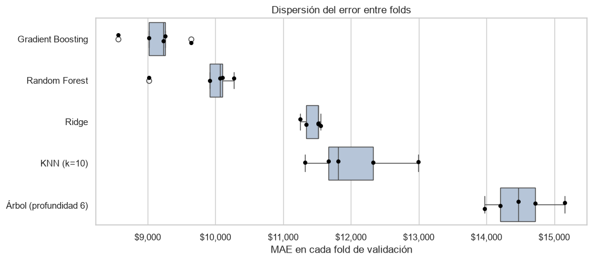
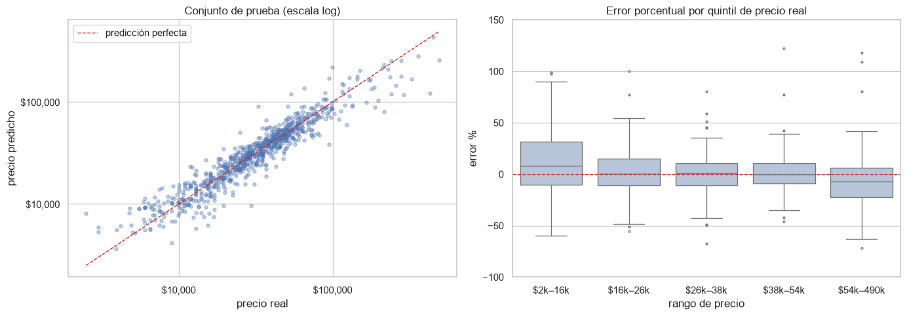
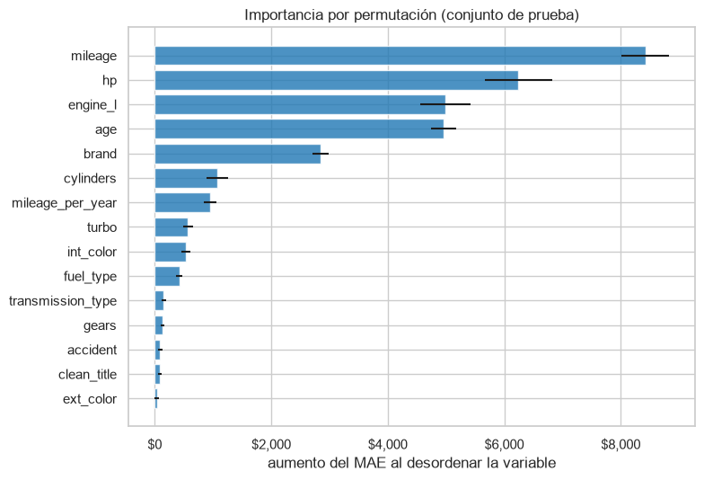

# 🚗 Predicción del precio de coches usados

Proyecto final del curso de Inteligencia Artificial. A partir de 4.009 anuncios reales de coches
usados se construye un modelo que estima su precio de venta, pasando por:

- **EDA** (análisis exploratorio) y **limpieza** de datos reales y desordenados.
- **Feature engineering**: extracción de variables a partir de texto libre.
- Un **pipeline** de `scikit-learn` sin fuga de información.
- Un **torneo de 6 modelos** con validación cruzada para elegir el mejor, justificando la elección.
- Una **evaluación final honesta** en un conjunto de prueba reservado desde el principio.

📓 **Notebook completo:** [`proyecto_precio_coches_usados.ipynb`](proyecto_precio_coches_usados.ipynb)

---

## Resultado del torneo

| Puesto | Modelo | MAE validación cruzada |
|---|---|---|
| 🏆 1 | **Gradient Boosting (ajustado)** | **8.832 $** |
| 2 | Random Forest (ajustado) | 9.615 $ |
| 3 | Ridge | 11.434 $ |
| 4 | KNN (k=10) | 12.024 $ |
| 5 | Árbol de decisión | 14.504 $ |
| 6 | Baseline (mediana) | 24.774 $ |

**En el conjunto de prueba**, el campeón obtiene un **MAE de 8.582 $**, un **MAPE del 19,1 %** y un
**R² de 0,78**, en línea con lo que predijo la validación cruzada.



### ¿Por qué gana Gradient Boosting?

1. Es **primero en las cuatro métricas** (MAE, RMSE, MAPE y R²) y supera a **cada rival en los 5
   folds** de validación cruzada.
2. Es el que mejor **equilibra sesgo y varianza**. Ridge es demasiado rígido (sesgo), mientras que el
   árbol y Random Forest memorizan el conjunto de entrenamiento (varianza).
3. Captura las relaciones **no lineales** y las **interacciones** del precio: la depreciación es
   exponencial y la cilindrada solo importa combinada con la potencia y la marca.
4. **Sin ajustar ya superaba a Random Forest ajustado**, así que la ventaja viene de la familia del
   modelo y no de la configuración.
5. Se entrena unas 4,5 veces más rápido que Random Forest.



---

## Qué hay en el notebook

| Sección | Contenido |
|---|---|
| 1–3 | El problema, la carga de datos y el EDA inicial: tipos incorrectos, nulos disfrazados, texto libre |
| 4 | Limpieza y feature engineering: precio y kilometraje a número, extracción de potencia, cilindrada y cilindros del texto del motor, recuperación de eléctricos, simplificación de transmisión y colores, tratamiento de atípicos |
| 5 | EDA sobre los datos limpios: distribución del precio, correlaciones y variables categóricas |
| 6–7 | División entrenamiento / prueba y pipeline de preprocesamiento (imputación, escalado, one-hot, objetivo logarítmico) |
| 8–9 | Torneo, ronda 1: seis modelos con validación cruzada, ranking por métrica y duelo fold a fold |
| 10–11 | Diagnóstico de sesgo y varianza; efecto de transformar el objetivo |
| 12–13 | Torneo, final: ajuste de hiperparámetros de los finalistas y justificación del campeón |
| 14–16 | Evaluación final en prueba, análisis de errores, importancia de variables y conclusiones |



---

## Estructura del repositorio

```
├── proyecto_precio_coches_usados.ipynb   <- notebook del proyecto
├── data/
│   └── used_cars.csv                     <- dataset (CC BY 4.0, ver abajo)
├── images/                               <- figuras usadas en este README
├── models/                               <- aquí se guarda el modelo entrenado al ejecutar el notebook
├── requirements.txt
└── README.md
```

## Cómo ejecutarlo

```bash
git clone <url-de-este-repositorio>
cd <carpeta-del-repositorio>
python -m venv .venv
# Windows: .venv\Scripts\activate    |    macOS/Linux: source .venv/bin/activate
pip install -r requirements.txt
jupyter notebook proyecto_precio_coches_usados.ipynb
```

El notebook completo se ejecuta en unos 1,5 minutos. Si falta `data/used_cars.csv`, lo descarga
automáticamente de Kaggle con `kagglehub`.

## Tecnologías

Python · pandas · NumPy · scikit-learn · matplotlib · seaborn · Jupyter

## Datos y atribución

Dataset: [**Used Car Price Prediction Dataset**](https://www.kaggle.com/datasets/taeefnajib/used-car-price-prediction-dataset),
de **Taeef Najib**, publicado en Kaggle bajo la licencia
[Creative Commons Attribution 4.0 International (CC BY 4.0)](https://creativecommons.org/licenses/by/4.0/).
Se incluye en `data/` sin modificaciones. Toda la limpieza se hace dentro del notebook.

## Limitaciones

- El modelo no usa el modelo concreto ni el acabado del coche (1.898 valores distintos), que es la
  principal fuente de error que queda.
- Solo es válido para coches de hasta 500.000 $ del mercado estadounidense (cars.com, 2023–2024).
- El error relativo es mayor en los coches más baratos (menos de 16.000 $).
